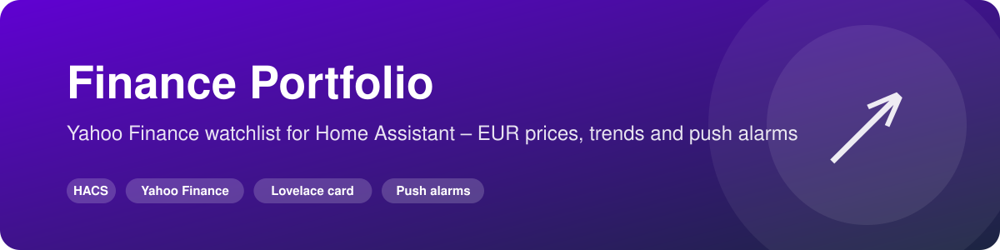
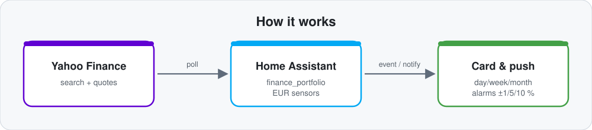
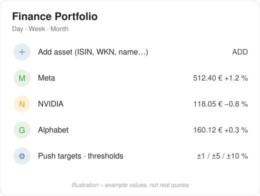

# Finance Portfolio

[English](README.md) · **Deutsch**

[](https://hacs.xyz)



Home-Assistant-Integration für eine kleine Watchlist bzw. ein Depot auf Basis von Yahoo Finance.

Version `0.3.5` ist mit Home Assistant `2026.8` kompatibel und gegen `2026.8.1` getestet.

Sie legt Kurssensoren in Euro, Prozent-Sensoren für Tag/Woche/Monat, einen Master-Sensor fürs Depot und optional eine Lovelace-Karte mit Hinzufügen/Entfernen an.





*Illustration – Beispielwerte, keine echten Kurse.*

## Funktionen

- Werte per Freitextsuche, ISIN, WKN, Name oder Yahoo-Symbol hinzufügen
- Automatische Yahoo-Suche mit Rückfall auf direkte Yahoo-Symbole
- Manuelle WKN-Zuordnung für Symbole, die Yahoo nicht zuverlässig findet
- Umrechnung in Euro für Kurse in anderen Währungen
- Sensoren pro Wert:
  - Kurs in Euro
  - Tagesveränderung in %
  - Wochenveränderung in %
  - Monatsveränderung in %
- Master-Sensor mit allen Kartendaten: `sensor.finance_portfolio_assets`
- Lovelace-Karte:
  - Eingabefeld für neue Werte
  - Entfernen-Knopf pro Wert
  - anklickbare Tag/Woche/Monat-Schalter
  - Einstellungstabelle für Push-Ziele und Alarmschwellen pro Wert
- Einstellbare Push-Alarme pro Wert für +1/+5/+10 % und −1/−5/−10 %
- Globale Push-Ziele über Home-Assistant-Notify-Dienste

## Installation mit HACS

1. Dieses Repository in HACS als benutzerdefiniertes Repository hinzufügen: `https://github.com/dr-apple/yahoo-finance-portfolio`
2. Kategorie: `Integration`.
3. `Finance Portfolio` installieren.
4. Home Assistant neu starten.
5. **Einstellungen > Geräte & Dienste > Integration hinzufügen**.
6. **Finance Portfolio** suchen und hinzufügen.

YAML-Import geht auch. Nur wer YAML bevorzugt, ergänzt in der `configuration.yaml`:

```yaml
finance_portfolio:
```

Danach Home Assistant noch einmal neu starten.

## Lovelace-Karte

Diese Dashboard-Ressource hinzufügen:

```text
/finance_portfolio/finance-portfolio-card.js
```

Ressourcentyp:

```text
module
```

Dann die Karte einfügen:

```yaml
type: custom:finance-portfolio-card
entity: sensor.finance_portfolio_assets
```

Nach einem Update der Karte den Browser hart neu laden oder einen Cache-Buster an die Ressourcen-URL hängen:

```text
/finance_portfolio/finance-portfolio-card.js?v=1
```

## Push-Alarme

Die Karteneinstellungen über das Zahnrad in der Karte öffnen.

1. Unter **Push-Ziele** ein oder mehrere `notify.*`-Ziele hinzufügen – Vorschlag wählen oder von Hand eintragen:

```text
notify.mobile_app_my_iphone, notify.mobile_app_ipad
```

2. Die aktiven Plus-/Minus-Schwellen pro Wert in der Tabelle setzen:

```text
+1%, +5%, +10%
-1%, -5%, -10%
```

Für eigene Automationen feuert die Integration weiterhin dieses Event:

```text
finance_portfolio_alarm
```

Event-Daten:

```text
asset_id, name, symbol, direction, change_pct, threshold, reference, price_eur
```

## Dienste

### `finance_portfolio.add_asset`

Wert hinzufügen oder aktualisieren. Beispiele:

```yaml
service: finance_portfolio.add_asset
data:
  query: Meta Platforms
  force: true
```

```yaml
service: finance_portfolio.add_asset
data:
  isin: US30303M1027
  name: Meta
  icon: mdi:facebook
  force: true
```

```yaml
service: finance_portfolio.add_asset
data:
  symbol: NVDA
  name: NVIDIA
  icon: mdi:memory
  force: true
```

Felder:

- `query`: Freitextsuche, ISIN, WKN, Name oder Yahoo-Symbol
- `isin`: ISIN
- `wkn`: WKN
- `symbol`: direktes Yahoo-Symbol
- `name`: optionaler Anzeigename
- `icon`: optionales MDI-Symbol
- `force`: vorhandenen Wert mit derselben ID überschreiben

### `finance_portfolio.remove_asset`

```yaml
service: finance_portfolio.remove_asset
data:
  asset_id: a1jwvx
```

### `finance_portfolio.refresh`

Alle Kurse sofort aktualisieren.

```yaml
service: finance_portfolio.refresh
```

### `finance_portfolio.reset_alarm`

Hoch-/Tief-Referenz für den Alarm eines Werts zurücksetzen.

```yaml
service: finance_portfolio.reset_alarm
data:
  asset_id: a1jwvx
```

### `finance_portfolio.set_alert`

Push-Alarmschwellen für einen Wert einstellen.

```yaml
service: finance_portfolio.set_alert
data:
  asset_id: a1jwvx
  enabled: true
  up_thresholds:
    - 1
    - 5
    - 10
  down_thresholds:
    - 1
    - 5
    - 10
```

## Manuelle Zuordnungen

Yahoo findet deutsche WKNs nicht immer. Die Integration enthält eine kleine Zuordnungstabelle in:

```text
custom_components/finance_portfolio/const.py
```

Beispiel:

```python
MANUAL_WKN_SYMBOLS = {
    "A1JWVX": "META",
    "A14Y6F": "GOOGL",
    "US02079K3059": "GOOGL",
}
```

Weitere Einträge ergänzen, wenn die Yahoo-Suche eine WKN oder ISIN nicht zuverlässig findet.

## Entitäten

Für die Wert-ID `a1jwvx` entstehen:

```text
sensor.finance_portfolio_a1jwvx_kurs_euro
sensor.finance_portfolio_a1jwvx_tageskursveranderung_prozent
sensor.finance_portfolio_a1jwvx_wochenkursveranderung_prozent
sensor.finance_portfolio_a1jwvx_monatskursveranderung_prozent
```

Der Master-Sensor ist `sensor.finance_portfolio_assets`. Sein Attribut `assets` nutzt die Lovelace-Karte.

## Beispiel-Automation

Selbst auf das Event `finance_portfolio_alarm` reagieren, z. B. bei starkem Kursrutsch eine Lampe rot blinken lassen:

```yaml
triggers:
  - trigger: event
    event_type: finance_portfolio_alarm
    event_data:
      direction: down
conditions:
  - condition: template
    value_template: "{{ trigger.event.data.threshold >= 5 }}"
actions:
  - action: light.turn_on
    target:
      entity_id: light.buero
    data:
      color_name: red
      flash: short
```

`direction` ist `up` oder `down`, `threshold` die überschrittene Schwelle in Prozent.

## Fehlersuche

| Problem | Lösung |
|---|---|
| WKN/ISIN wird nicht gefunden | Das Symbol direkt angeben (`symbol: …`) oder `MANUAL_WKN_SYMBOLS` in `const.py` ergänzen. |
| Karte zeigt alte Version | Browser hart neu laden oder `?v=2` an die Ressourcen-URL hängen. |
| `custom:finance-portfolio-card` nicht gefunden | Ressource `/finance_portfolio/finance-portfolio-card.js` (Typ *module*) hinzufügen. |

> Die Kurse stammen von Yahoo Finance und können verzögert sein. Keine Anlageberatung.

## Repository-Aufbau

```text
.
├── custom_components/
│   └── finance_portfolio/
│       ├── __init__.py
│       ├── config_flow.py
│       ├── const.py
│       ├── manifest.json
│       ├── sensor.py
│       ├── translations/
│       ├── services.yaml
│       └── www/
│           └── finance-portfolio-card.js
├── hacs.json
├── README.md
└── .gitignore
```

## Lizenz

MIT – siehe [LICENSE](LICENSE). Kein offizielles Yahoo-Projekt.
